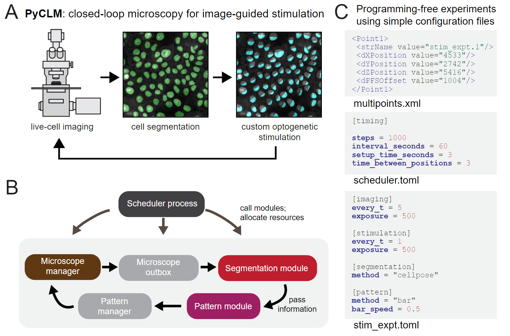

PyCLM
=====

PyCLM runs many optogenetic experiments at once on one microscope. Each
imaging position gets its own light pattern, projected through a DMD, that can
be fixed, change over time, follow individual cells, or respond to what the
cells are doing. Experiments are written as short TOML files, so running a new
one needs no programming; a new kind of light rule is a small Python class.

Start here
----------

- **See what it can do:** the :doc:`method_zoo` shows every built-in pattern
  method on a sample image, with a ``[pattern]`` table to copy into an
  experiment.
- **Try it without a microscope:**

  .. code-block:: bash

     pip install "closed-loop-microscopy[gui]"
     pyclm new demo --demo
     pyclm run demo --dry --gui

  Then paste a table from the zoo over the ``[pattern]`` table in
  ``demo/cells.toml`` (keep ``channel = "545"``) and run it again.
- **Set it up on your microscope:** :doc:`installation`, then
  :doc:`first_time_setup`.
- **Run experiments:** :doc:`usage` gives the workflow; :doc:`experiment_tomls`
  and :doc:`command_line` are the reference.
- **Write your own light rule:** :doc:`custom_pattern_methods` and
  :doc:`tracking`.
- **Open the data:** :doc:`data_format`.
- **Get walked through it:** three `agent skills
  <https://github.com/Harrison-Oatman/PyCLM/tree/main/.claude/skills>`_ let a
  coding agent such as Claude Code guide you through microscope setup,
  designing an experiment, and writing a pattern method. The hint boxes on
  those pages say which one to use.

.. toctree::
   :maxdepth: 2
   :caption: Getting started

   installation
   first_time_setup
   usage

.. toctree::
   :maxdepth: 2
   :caption: Pattern methods

   method_zoo
   custom_pattern_methods
   tracking

.. toctree::
   :maxdepth: 2
   :caption: Reference

   experiment_tomls
   command_line
   data_format
   api/index
